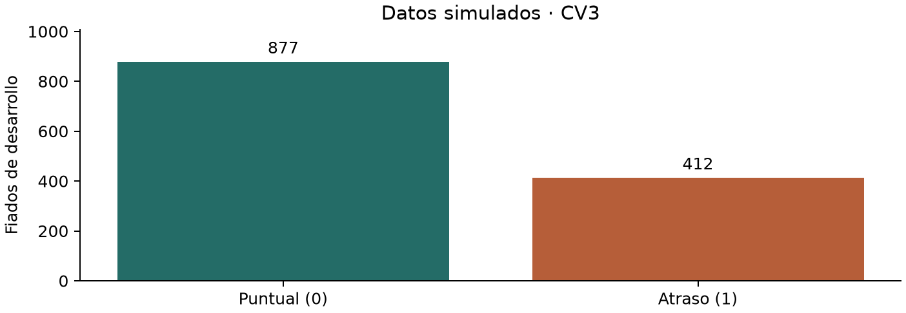
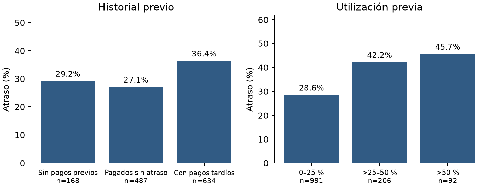
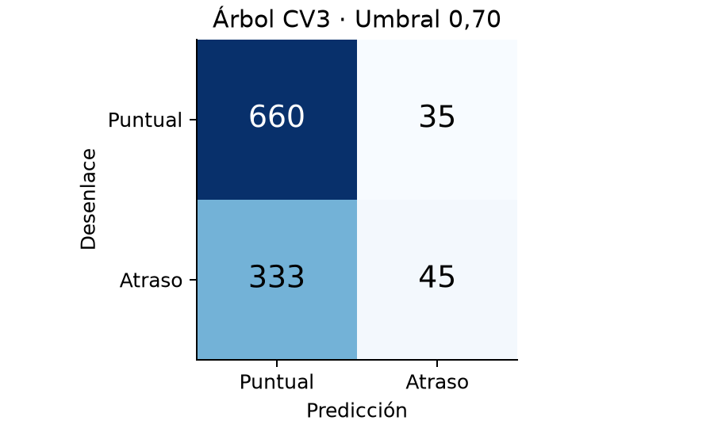

# Solución de Machine Learning para el fiado a un día en Cervecería Baylón

## Avance de Proyecto Formativo 3 · Grupo 2 · Evaluación corregida CV3

Facultad de Ingeniería de Sistemas e Informática · Universidad Tecnológica del Perú

Caso 4: Scoring crediticio alternativo con IA para el fiado y microcrédito MYPE

| Integrante | Código |
| --- | --- |
| Omara Yamileth Baylón Vila | U23231338 |
| Tamara Alison Coveñas Quispe | U23204737 |
| César Augusto Daniel Paredes Paredes | U23259768 |
| Pablo Enrique Yman Avila | U23251279 |

Docente: Caman Sanchez, Richard Enrique · Sección 35036 · Lima, Perú · 2026-2

**Versión documental:** CV3, 12 de noviembre de 2026. Base técnica: `academic-grouped-cv-v3`, reporte congelado a las 22:25:01 UTC. Cuerpo planificado: 14 páginas, además de portada, referencias y anexos.

**Alcance académico.** Todos los registros del experimento son ficticios. La comparación corregida ya fue ejecutada; este informe utiliza sus resultados guardados, sin entrenar, ajustar umbrales, generar datos ni reevaluar el test. No demuestra reducción de pérdidas, calibración para clientes reales ni autorización automática de créditos. La revisión humana y los pendientes de negocio y normativa siguen abiertos.

<!-- PAGE -->

# 1. Resumen ejecutivo y continuidad

## 1.1. De APF1 y APF2 a la comparación corregida

Cervecería Baylón es un negocio familiar de San Martín de Porres, Lima, operado por dos propietarios. APF1 identificó el fiado a un día administrado con cuaderno y criterio personal, sin historial digital analizable. APF2 desarrolló Credify, un MVP con clientes, evaluación preliminar por reglas, fiados, abonos e historial persistente. Se conservan empresa, equipo, unidad de análisis y problema; Lean Startup y Kanban orientan la evolución, pero no sustituyen la evaluación predictiva (Grupo 2, 2026a, 2026b).

Al cierre documentado de APF2 no había comenzado el piloto real y el exportador devolvió cero fiados elegibles. Esto no probaba ausencia de otras operaciones. Los registros usados aquí siguen siendo ficticios: la simulación académica no acredita la captura de 30 a 50 fiados reales prevista en APF2.

CV3 corrige la comparación metodológica del borrador anterior: compara árbol de decisión y SVM lineal con dos referencias Dummy, utiliza validación cruzada agrupada y registra entrenamiento, predicción fuera de pliegue y evaluación final común. No modifica retrospectivamente los resultados v1/v2 ni traslada sus métricas al test CV3.

## 1.2. Problema ML y resultado principal

**Para los propietarios, se busca clasificar si un fiado evaluado tendrá atraso respecto al vencimiento contractual, usando información disponible antes de otorgarlo, para apoyar una revisión humana.** Es clasificación binaria supervisada; cada fila es un fiado y el target es `late_payment`. No se predice pérdida definitiva ni mora a 30 días.

El criterio técnico preestablecido fue maximizar F2 con precisión de la clase atraso ≥ 0,50. Es provisional, no un acuerdo con el propietario. Ganó el árbol balanceado, profundidad máxima 3, hoja mínima 16 y umbral 0,70. Su F2 OOF fue 0,25641 y su F2 final 0,14133. En el test detectó 45 de 378 atrasos, con 35 falsas alertas: **recall bajo, 11,90 %**.

La SVM no emitió alertas finales. El Dummy siempre positivo logró mayor F2, 0,73114, pero precisión 0,35228, inferior al piso. La referencia mayoritaria obtuvo accuracy 0,64772 frente a 0,65704 del árbol. No hay superioridad universal, estadística o financiera demostrada.

<!-- PAGE -->

# 2. Datos, procedencia y alcance

## 2.1. Separación de desarrollo y evaluación

La fuente de desarrollo es el libro sintético de ejecución-02, identificado por SHA-256. Se reutilizan únicamente sus etiquetas resueltas de train y validación originales. El test antiguo ya consultado y toda la cohorte final publicada de v2 quedan fuera de la selección CV3. No se agregan estos conjuntos para presentar una sola prueba independiente.

| Conjunto o exclusión | Filas o fiados | Clientes | Uso en CV3 |
| --- | --- | --- | --- |
| Desarrollo etiquetado | 1289 | 125 | Búsqueda OOF y ajuste final |
| Aporte de train original | 943 | Incluidos en los 125 | Parte de desarrollo |
| Aporte de validación original | 346 | Incluidos en los 125 | Parte de desarrollo |
| Test original etiquetado | 309 | No incorporados | Excluido; ya consultado |
| Fuente original sin desenlace | 24 | No se suman al desarrollo | Excluida del supervisado |
| Cohorte final nueva CV3 | 1091 | 120 | 1073 evaluables y 18 sin desenlace |

El reporte registra 333 filas excluidas de la fuente original: 309 etiquetadas del test antiguo más 24 sin etiqueta. Desarrollo contiene 877 casos de clase 0 y 412 de clase 1. La cohorte CV3 contiene 695 de clase 0, 378 de clase 1 y 18 desconocidos; estos últimos no se imputan ni entran a las métricas.

## 2.2. Coherencia del escenario, no representatividad

El simulador existente conserva plazo contractual de un día, clientes y abonos ficticios, montos positivos acotados por cupo, pagos que no exceden deuda, snapshots previos y etiquetas reconstruidas desde pagos. El reporte final registra 1412 pagos y controles temporales y de separación de clientes. Se conserva `origen=simulado`; no son clientes reales anonimizados.

La ficha heredada describe seis perfiles, montos lognormales con parámetros 3,85 y 0,55 y cupo simulado S/ 200, entre otros supuestos. **La calibración cuantitativa con fuentes verificables del negocio o sector sigue PENDIENTE.** El fiado a un día y los abonos tienen continuidad con APF1/APF2, pero ello no valida frecuencias, montos, volumen o probabilidades del generador. Superar referencias orientativas de tamaño no resuelve esa brecha.

La semilla final 20261117 estaba declarada antes de generar CV3. Se usó el mismo generador sin cambios; no se volvió a elegir semilla después de observar resultados. Los 120 clientes finales son distintos de los de la fuente, pero no constituyen validación externa. APF1 contemplaba simulación complementaria y APF2 priorizó un piloto real: usar ahora una fuente totalmente ficticia es un cambio de fuente declarado ante la ausencia del piloto, no su cumplimiento. La consigna permite simulación justificada, pero todavía exige calibración verificable.

<!-- PAGE -->

## 2.3. Contrato de variables y preparación

## 2.3.1. Información disponible antes del fiado

Se conserva el contrato de once variables de APF2 y su orden. `late_payment=0` indica pago completo dentro del plazo; `1`, atraso según el desenlace observado. Un caso todavía sin desenlace mantiene etiqueta desconocida. Perfiles y escenarios sirven para auditar, no para predecir.

| Predictor | Unidad | Significado previo a la evaluación |
| --- | --- | --- |
| completed_sales | Conteo | Ventas completadas |
| paid_credits | Conteo | Fiados pagados completos |
| paid_late | Conteo | Pagados completos con atraso |
| pending_overdue | Conteo | Fiados activos vencidos |
| pending_current | Conteo | Fiados activos no vencidos |
| outstanding | PEN | Deuda previa pendiente |
| utilization | Ratio | Deuda previa / cupo |
| requested_ratio | Ratio | Monto solicitado / cupo |
| tenure_days | Días | Antigüedad al evaluar |
| punctuality_rate | Ratio | Pagados puntuales / pagados completos |
| overdue_rate | Ratio | Activos vencidos / activos totales |

Cuando no hay pagos completos, `punctuality_rate` vale cero; se interpreta junto con `paid_credits`, no como incumplimiento demostrado. Sin activos, `overdue_rate` vale cero. Se excluyen IDs, fechas futuras, perfil, escenario, split, saldo al corte, procedencia y etiqueta del vector de aprendizaje. No se usa el score del MVP como target.

## 2.3.2. Preprocesamiento sin fuga

Ambos modelos incorporan `SimpleImputer(strategy="median")` y `StandardScaler` en Pipeline. En cada pliegue, medianas, medias y escalas se ajustan solo con su porción de entrenamiento. En la SVM, el Pipeline queda dentro del estimador calibrado para repetir esa separación también en los pliegues internos. El escalado del árbol mantiene un procesamiento común; no implica que los árboles lo necesiten para particionar.

La imputación es una salvaguarda explícita frente a faltantes, no una afirmación de que se hayan inventado datos ausentes en el generador. No se imputa el target ni se eliminan snapshots iguales por sí solos: dos fiados pueden compartir un historial legítimo. Los controles verifican finitud, esquema y unicidad de IDs. La agrupación impide que un cliente aparezca simultáneamente en entrenamiento y validación de un pliegue (Scikit-learn developers, s. f.-a, s. f.-b).

<!-- PAGE -->

## 2.4. EDA de desarrollo: balance y escala

El EDA documental utiliza exclusivamente las **1289 filas etiquetadas de desarrollo**, correspondientes a 125 clientes ficticios. Incluye train y validación originales, no el test antiguo ni CV3. Se prepara desde las filas guardadas; no participa en una nueva selección y no se presenta como un análisis prospectivo anterior a la corrida congelada.



**Conclusión de balance.** Hay 877 casos de clase 0, 68,04 %, y 412 de clase 1, 31,96 %. Una predicción siempre puntual ya consigue accuracy 0,68037 en desarrollo sin detectar atrasos. Por ello se informa detección de la clase 1, además de accuracy, y se contrastan dos Dummies con comportamientos extremos.

| Variable | Mín. | Media | Mediana | Máx. |
| --- | --- | --- | --- | --- |
| requested_amount | 10.00 | 51.93 | 47.12 | 200.00 |
| paid_credits | 0.00 | 4.30 | 4.00 | 12.00 |
| paid_late | 0.00 | 1.02 | 0.00 | 8.00 |
| outstanding | 0.00 | 28.24 | 0.00 | 187.77 |
| utilization | 0.00 | 0.14 | 0.00 | 0.94 |
| tenure_days | 0.00 | 73.00 | 73.00 | 153.00 |

La tabla descriptiva se reserva para estadísticos calculados sobre esas mismas filas de desarrollo. Sus unidades son conteos, días, PEN y ratios según el diccionario. El monto solicitado bruto no es un predictor adicional: el contrato utiliza `requested_ratio`. El tamaño muestral por fila no debe confundirse con 1289 clientes independientes.

Los valores extremos describen límites y comportamientos del escenario simulado; no justifican borrar casos reales futuros ni establecer un cupo comercial. El cupo S/ 200 es un supuesto del generador. La tabla y la figura no prueban que el negocio tenga esta prevalencia de atraso, este volumen de ventas o esta distribución de montos.

<!-- PAGE -->

## 2.5. EDA de desarrollo: relaciones

Se describen dos relaciones pertinentes al problema: historial de pagos tardíos frente al atraso del nuevo fiado y exposición previa frente a ese atraso. Las bandas del gráfico son resúmenes descriptivos, no nuevas reglas comerciales ni umbrales de selección. Los denominadores deben acompañar las tasas para no sobrerrepresentar grupos pequeños.



**Conclusión sobre historial.** Sin pagos previos: 29.17 % (n=168); Pagados sin atraso: 27.10 % (n=487); Con pagos tardíos: 36.44 % (n=634).

La relación procede de un generador con persistencia y cambios de comportamiento. No demuestra una magnitud equivalente en clientes del negocio ni permite tratar la falta de historial como prueba de incumplimiento. Las operaciones de un mismo cliente están relacionadas; la CV utiliza esa agrupación, no una separación aleatoria por fiado.

**Conclusión sobre exposición.** 0–25 %: 28.56 % (n=991); >25–50 %: 42.23 % (n=206); >50 %: 45.65 % (n=92).

La exposición es previa al nuevo fiado. Una asociación no implica que reducir el cupo cause puntualidad ni que elevarlo cause atraso. Si las bandas no son monotónicas o tienen pocos casos, debe informarse esa limitación sin modificar datos. En el escenario, `utilization` y `outstanding` están vinculadas por el cupo simulado, lo que limita interpretaciones independientes.

La plausibilidad visual no cierra la trazabilidad de parámetros. Sigue pendiente contrastar la escala, frecuencias, montos y probabilidades con evidencia cuantitativa verificable. Los gráficos del cuerpo se construyen desde desarrollo; la matriz posterior se construye desde métricas finales ya guardadas, no mediante nuevas predicciones del test.

<!-- PAGE -->

# 3. Modelado y comparación CV3

## 3.1. Espacio declarado antes de la prueba final

Se compararon dos familias pertinentes al taller y al problema: árbol, para relaciones no lineales con reglas inspeccionables, y SVM lineal, para una frontera regularizada sobre variables escaladas. Se añadieron dos referencias Dummy sobre las mismas cohortes.

| Componente | Valores del protocolo congelado |
| --- | --- |
| Árbol de decisión | max_depth: 2, 3, 4; min_samples_leaf: 8, 16; class_weight: None, balanced |
| SVM lineal | C: 0,1, 1, 10; class_weight: None, balanced; probability=False |
| Estimadores | random_state=42 |
| Umbrales | 0,20; 0,30; 0,40; 0,50; 0,60; 0,70; 0,80 |
| CV de selección | StratifiedGroupKFold, 5 pliegues, shuffle=True, semilla 20261112, grupo client_id |
| Calibración SVM | Sigmoide, 3 pliegues agrupados, semilla 20261114, ensemble=False |
| Referencias | Dummy most_frequent y Dummy constant=1; umbral 0,50 |

Son 12 configuraciones de árbol y 6 de SVM: **18 configuraciones y 126 combinaciones configuración/umbral**, no 126 algoritmos. Cada fila de desarrollo recibe una predicción OOF de un modelo que no la usó para ajustarse ni vio a su cliente en su entrenamiento. La estratificación procura conservar ambas clases, pero la agrupación no garantiza tamaños idénticos de pliegue.

## 3.2. Calibración interna y alcance de OOF

Para cada entrenamiento externo de la SVM se crean tres particiones internas agrupadas exclusivamente dentro de él. El preprocesamiento se ajusta dentro de los estimadores internos y la sigmoide usa márgenes fuera de esos entrenamientos. Al reajustar sobre todo desarrollo, la calibración también es agrupada y permanece fuera del test final.

**Esto es calibración anidada, no evaluación anidada independiente de hiperparámetros.** Las mismas predicciones OOF sirven para buscar configuración y umbral; por tanto, la métrica OOF del ganador es optimista como estimación de su desempeño futuro. La evaluación final común reduce esa reutilización para CV3, pero no elimina el sesgo de fuente del simulador ni convierte probabilidades en riesgo real calibrado.

<!-- PAGE -->

## 3.3. Criterio y selección congelada

## 3.3.1. Supuesto técnico, no compromiso comercial

Se eligió el mayor F2 entre combinaciones con precisión de atraso ≥ 0,50. F2 pondera recall más que precisión: `F2 = 5 × P × R / (4 × P + R)`, equivalente a `5TP / (5TP + 4FN + FP)`. El piso busca, provisionalmente, al menos tantas alertas correctas como falsas. No representa costos medidos, capacidad de revisión ni meta aprobada por los propietarios.

Los desempates declarados son recall, F1, precisión, orden previo de candidato y cercanía del umbral a 0,50. Se selecciona un candidato por familia y luego el global. Si ninguno cumple el piso, el protocolo exige declarar la falta de factibilidad y mantener el resultado solo como referencia de investigación. Aquí ambos ganadores de familia cumplieron el piso OOF, sin acreditar preparación comercial.

| Candidato congelado | Configuración | Umbral | Precisión OOF | Recall OOF | F2 OOF |
| --- | --- | --- | --- | --- | --- |
| Árbol, índice 7 | Profundidad 3; hoja 16; balanced | 0,70 | 0,50811 | 0,22816 | 0,25641 |
| SVM, índice 12 | Lineal; C=0,1; sin pesos | 0,50 | 0,53846 | 0,01699 | 0,02107 |
| Dummy mayoritario | most_frequent | 0,50 | 0,00000 | 0,00000 | 0,00000 |
| Dummy siempre positivo | constant=1 | 0,50 | 0,31963 | 1,00000 | 0,70140 |

El árbol ganó **dentro de la restricción declarada**. El Dummy positivo tiene F2 mayor y no es elegible por precisión; no se oculta ese resultado ni se afirma superar ambas referencias. La precisión cero de la referencia sin alertas corresponde a la convención `zero_division=0`.

## 3.3.2. Frontera entre exploración y test

`frozen_selection.json` se guardó el 12/11/2026 a las 22:25:01,111715 UTC con parámetros, umbrales, orden de variables y hashes. Después se exportaron los modelos reajustados con las 1289 filas de desarrollo y se generó la cohorte final con semilla previamente fijada 20261117. Los cuatro modelos congelados recibieron una única evaluación sobre las mismas 1073 etiquetas finales.

No se cambiaron semilla, criterio, configuraciones o umbrales al conocer ese test. Desde su publicación, CV3 también es un conjunto consultado: una futura selección requiere reservar otra prueba no observada. La redacción, figuras y análisis de errores reutilizan resultados guardados, no ejecutan inferencia adicional sobre filas finales.

<!-- PAGE -->

## 3.4. Contraste de entrenamiento, OOF y final

Entrenamiento corresponde al reajuste con todo desarrollo; OOF agrega las predicciones de los cinco modelos externos de cada candidato. No son las predicciones de un único modelo aplicadas a una validación fija. Final corresponde a la cohorte CV3 común. Valores redondeados a cinco decimales, clase positiva: atraso.

| Modelo | Evaluación | Precisión | Recall | F2 | Accuracy |
| --- | --- | --- | --- | --- | --- |
| Árbol, umbral 0,70 | Train, n=1289 | 0,71795 | 0,13592 | 0,16222 | 0,70675 |
| Árbol, umbral 0,70 | OOF, n=1289 | 0,50811 | 0,22816 | 0,25641 | 0,68270 |
| Árbol, umbral 0,70 | Final, n=1073 | 0,56250 | 0,11905 | 0,14133 | 0,65704 |
| SVM, umbral 0,50 | Train, n=1289 | 0,00000 | 0,00000 | 0,00000 | 0,68037 |
| SVM, umbral 0,50 | OOF, n=1289 | 0,53846 | 0,01699 | 0,02107 | 0,68115 |
| SVM, umbral 0,50 | Final, n=1073 | 0,00000 | 0,00000 | 0,00000 | 0,64772 |
| Dummy mayoritario | Train, n=1289 | 0,00000 | 0,00000 | 0,00000 | 0,68037 |
| Dummy mayoritario | OOF, n=1289 | 0,00000 | 0,00000 | 0,00000 | 0,68037 |
| Dummy mayoritario | Final, n=1073 | 0,00000 | 0,00000 | 0,00000 | 0,64772 |
| Dummy positivo | Train, n=1289 | 0,31963 | 1,00000 | 0,70140 | 0,31963 |
| Dummy positivo | OOF, n=1289 | 0,31963 | 1,00000 | 0,70140 | 0,31963 |
| Dummy positivo | Final, n=1073 | 0,35228 | 1,00000 | 0,73114 | 0,35228 |

**Lectura del contraste.** El árbol tiene F2 de entrenamiento menor que OOF, no mayor. Sus alertas pasan de 78 en train a 185 OOF y 80 finales. El mismo umbral puede activar hojas distintas al cambiar los datos de ajuste; el reajuste completo y los modelos de pliegue no producen idénticas probabilidades. La selección del mejor resultado OOF agrega optimismo de búsqueda. No corresponde describirlo simplemente como el patrón clásico «train superior a validación».

En SVM, las 13 alertas OOF, siete correctas, desaparecen tanto en train reajustado como en final. Esto evidencia sensibilidad al umbral y variabilidad de ajuste/calibración; no justifica bajar retrospectivamente el umbral. Su AUC train 0,64601 cae a 0,54569 OOF y llega a 0,63369 final, sin detectar positivos al umbral fijado.

El árbol pierde F2 y recall de OOF a final, pero estos números no separan por sí solos sobreajuste de selección, variabilidad de refit y diferencias muestrales. Todas las cohortes comparten sesgo del mismo generador. No se calcularon intervalos ni pruebas de significancia; 1073 fiados no equivalen a 1073 clientes independientes.

<!-- PAGE -->

# 4. Evaluación e interpretación de negocio

## 4.1. Comparación final común

La cohorte final tiene 120 clientes ficticios, 1091 fiados y 1073 etiquetas resueltas: 695 puntuales y 378 atrasadas. Se excluyen 18 desconocidas. La tabla compara los cuatro modelos congelados sobre **exactamente ese mismo conjunto**, a partir de `grouped_cv_report.json`, sin nuevos cálculos de predicción.

| Modelo | Precisión | Recall | F1 | F2 | Accuracy |
| --- | --- | --- | --- | --- | --- |
| Árbol, umbral 0,70 | 0,56250 | 0,11905 | 0,19651 | 0,14133 | 0,65704 |
| SVM, umbral 0,50 | 0,00000 | 0,00000 | 0,00000 | 0,00000 | 0,64772 |
| Dummy mayoritario | 0,00000 | 0,00000 | 0,00000 | 0,00000 | 0,64772 |
| Dummy siempre positivo | 0,35228 | 1,00000 | 0,52102 | 0,73114 | 0,35228 |

| Modelo | Balanced accuracy | ROC AUC | Brier | Alertas | Errores |
| --- | --- | --- | --- | --- | --- |
| Árbol | 0,53434 | 0,62789 | 0,23869 | 80 | 368 |
| SVM | 0,50000 | 0,63369 | 0,23010 | 0 | 378 |
| Dummy mayoritario | 0,50000 | 0,50000 | 0,35228 | 0 | 378 |
| Dummy siempre positivo | 0,50000 | 0,50000 | 0,64772 | 1073 | 695 |

**Lo que sí muestra la comparación.** El árbol detecta algunos atrasos y supera descriptivamente a la referencia mayoritaria en F2 y accuracy, esta última por unos 0,93 puntos porcentuales. Su precisión final es mayor que el piso técnico, aunque su recall es bajo. La SVM tiene AUC y Brier algo mejores que el árbol, pero no emite alertas con el umbral congelado. AUC mide ordenamiento de puntajes, no detección al umbral operativo.

**Lo que no muestra.** El árbol no supera al Dummy positivo en F2, F1 o recall. El F2 de 0,73114 de ese Dummy se obtiene alertando todos los fiados y con precisión 0,35228, por lo que incumple el piso. La elección del árbol depende de la restricción provisional; no demuestra dominancia general. La precisión cero de SVM y Dummy mayoritario es la convención ante ausencia de alertas, no una tasa estimada entre alertas existentes.

Un Brier menor no certifica calibración en clientes reales. La prueba final procede del mismo simulador no calibrado cuantitativamente al negocio. La evaluación es académica y descriptiva, no una validación externa ni una prueba de retorno financiero.

<!-- PAGE -->

## 4.2. Matriz y lectura de negocio



Las filas representan el desenlace y las columnas la predicción, en orden 0, 1. En el árbol hay 660 verdaderos negativos, 35 falsos positivos, 333 falsos negativos y 45 verdaderos positivos. De 80 alertas, 45 corresponden a atraso; de 378 atrasos, 333 quedan sin alertar. No es una buena cobertura de detección.

| Modelo | TN | FP | FN | TP |
| --- | --- | --- | --- | --- |
| Árbol | 660 | 35 | 333 | 45 |
| SVM | 695 | 0 | 378 | 0 |
| Dummy mayoritario | 695 | 0 | 378 | 0 |
| Dummy siempre positivo | 0 | 695 | 0 | 378 |

Un falso negativo deja un atraso sin revisión del modelo. Un falso positivo puede generar trabajo innecesario o, si se usa indebidamente, restringir una venta. Son consecuencias hipotéticas, no costos medidos. Una predicción 0 no garantiza cobro; una predicción 1 no prueba pérdida ni debe negar automáticamente el fiado.

APF2 precisó el 5 % referencial como `pérdida mensual estimada / ventas del mes × 100`, sin corroboración contable de un mes específico. **No es prevalencia de atraso, precisión, accuracy ni probabilidad de impago.** No se usó para etiquetar y no se declara reducido. APF1 registró evaluación automatizada inicial de 0 %, pero tampoco se demuestra aquí cobertura operativa real.

Si se obtuvieran costos justificados, el conteo ilustrativo del árbol sería `35 × C_FP + 333 × C_FN`. No es una estimación de pérdidas en soles: el atraso puede recuperarse y las acciones humanas cambian sus consecuencias. Falta acordar finalidad, capacidad de revisión, costos y una meta numérica observable con el propietario antes de evaluar impacto real.

<!-- PAGE -->

## 4.3. Tres errores finales ya registrados

Los siguientes casos del árbol se transcriben del caché `models.tree.error_cases` del reporte congelado. Se incluyen dos falsos negativos y un falso positivo de los errores ya exportados, no una muestra aleatoria ni una búsqueda para ajustar el modelo. Se omiten prefijos solo en la tabla: todos los préstamos comienzan con `CV3-`.

| Cliente ficticio | Préstamo | Escenario | Probabilidad guardada | Real / predicho | Error |
| --- | --- | --- | --- | --- | --- |
| CV3-C0002 | L00015 | abonos_tardios | 0,33009138676021355 | 1 / 0 | FN |
| CV3-C0002 | L00022 | atraso_largo | 0,6048536574852369 | 1 / 0 | FN |
| CV3-C0003 | L00031 | puntual | 0,8703555781473143 | 0 / 1 | FP |

**Caso CV3-L00015.** Tenía 11 ventas, 2 fiados pagados, ninguno tardío, deuda y utilización cero, ratio solicitado 0,0947, antigüedad 31 días y puntualidad 1. La historia previa favorable no impidió un desenlace con abonos tardíos. Es una hipótesis de cambio de comportamiento o señal insuficiente, no una causa comprobada.

**Caso CV3-L00022.** Tenía 23 ventas, 8 fiados pagados, 1 tardío, 1 pendiente vencido, deuda S/ 104,53, utilización 0,52265, ratio solicitado 0,1696, antigüedad 54 días, puntualidad 0,875 y tasa vencida 1. El puntaje 0,60485 no alcanzó el umbral 0,70 pese a la exposición previa. Ilustra una omisión dependiente del umbral, no una instrucción para corregirlo usando el test.

**Caso CV3-L00031.** Tenía 17 ventas, 6 fiados pagados, 4 tardíos, 2 vencidos activos, deuda S/ 66,97, utilización 0,33485, ratio solicitado 0,31305, antigüedad 93 días, puntualidad 0,33333 y tasa vencida 1. El historial desfavorable activó una alerta, pero el nuevo fiado fue puntual. La persistencia histórica no es determinista.

Los dos primeros pertenecen al mismo cliente; no son dos personas independientes. Los escenarios y desenlaces se conocen después para explicar errores, nunca entran al vector predictor. Las once variables exactas de estos casos permanecen en el JSON congelado. No se reevaluó ninguna fila final para redactar esta sección, y las hipótesis no se presentan como entrevistas o revisiones humanas realizadas.

<!-- PAGE -->

## 4.4. Interpretabilidad del modelo exportado

## 4.4.1. Una ruta completa del árbol en unidades originales

El reporte exporta reglas con los cortes transformados de vuelta desde el escalador a las unidades de entrada, después de imputación por medianas de entrenamiento. Una ruta completa de raíz a hoja es:

```text
utilization > 0.048950
punctuality_rate > 0.527778
requested_ratio > 0.188650
hoja: class 0
```

En términos del escenario, esa ruta combina utilización superior a 4,895 %, puntualidad previa superior a 52,7778 % y solicitud superior a 18,8650 % del cupo. Son cortes aprendidos en datos ficticios, redondeados a seis decimales, no límites comerciales validados. La exportación no altera el Pipeline guardado.

**La clase de hoja no sustituye la decisión con umbral.** La impresión `class` representa la clase dominante del árbol; la alerta CV3 aplica `probability >= 0.70`. Una hoja impresa como clase 1 puede quedar bajo 0,70, como ilustra el puntaje 0,60485 de CV3-L00022. No se debe implementar la clasificación final copiando únicamente las clases del texto.

## 4.4.2. SVM: margen, no explicación causal

| Variable | Coeficiente estandarizado exacto del reporte |
| --- | --- |
| paid_late | 0.0005501994243762566 |
| paid_credits | -0.00031633881959513177 |
| pending_overdue | 0.0002532142271544341 |
| punctuality_rate | 0.00019403228692036292 |

Los once coeficientes y el intercepto se incluyen en el Anexo B. Describen el margen lineal antes de la calibración sigmoide, por unidad estandarizada; no son cambios directos de probabilidad, efectos causales o importancia comercial. Un coeficiente positivo de puntualidad en este ajuste no autoriza penalizar al cliente puntual. Correlación de predictores, regularización y fuente sintética limitan su interpretación.

La inspección corresponde a los modelos CV3 registrados, no a `rules-v1` ni a la logística v2 de la demo. Ni las reglas del árbol ni los coeficientes acreditan ausencia de sesgo. Antes de cualquier uso real se necesitan revisión humana, datos trazables y evaluación de consecuencias, especialmente para clientes sin historial.

<!-- PAGE -->

# 5. Integración mínima con el MVP

## 5.1. Estado real y frontera de versión

La demo pública heredada está en https://demo-credify.168-75-71-113.sslip.io y el laboratorio en `/laboratorio-academico`. **El laboratorio web sigue en v2; no se actualizó a CV3.** Sus capturas y comprobaciones previas no prueban integración, aceptación ni disponibilidad actual de CV3. Este informe no fabrica capturas ni afirma una prueba de interfaz o aceptación por los propietarios.

La integración mínima CV3 disponible es independiente de la aplicación: función `predict(artifact_dir, input_data)` y modo CLI de `academic_credit_grouped_cv.py`. Carga el Pipeline serializado, valida el esquema de once campos y orden congelado, verifica hashes y aplica el umbral guardado. No entrena, genera clientes ni crea créditos operativos. Ese contrato puede conectarse al MVP más adelante, sin afirmar que ya exista un endpoint CV3.

## 5.2. Contrato JSON y ejemplo nuevo sin etiqueta

Entrada ilustrativa guardada, distinta de las filas de las cohortes y sin desenlace conocido:

```json
{"features":{"completed_sales":3,"paid_credits":2,"paid_late":1,"pending_overdue":0,"pending_current":0,"outstanding":0,"utilization":0,"requested_ratio":0.25,"tenure_days":45,"punctuality_rate":0.5,"overdue_rate":0}}
```

Salida resumida de `illustrative_prediction.json`, ya ejecutada al preparar el experimento:

```json
{"origen":"simulado","illustrative_only":true,"known_label":null,"family":"tree","probability":0.4559958404028253,"threshold":0.7,"predicted":0,"research_only":true}
```

La salida completa también conserva `feature_names` y `features`. `known_label=null` es metadato de salida, no entrada predictora. Se aceptan números finitos no negativos y `null` para imputación, con restricciones de conteos, ratios y `paid_late <= paid_credits`. No se acepta la etiqueta dentro de `features`. La inferencia ilustrativa no prueba acierto ni aprueba el crédito.

El Anexo C documenta CLI, dependencias y hash. La reproducción en un entorno nuevo, sin heredar bibliotecas del sistema y sin red durante la ejecución, obtuvo las mismas doce tablas de métricas train/OOF/final, selección e inferencia ilustrativa. Es una comprobación técnica del protocolo fijo, no otro test independiente. No se midieron latencia, memoria o SLA CV3. Joblib solo debe cargarse desde orígenes confiables: el hash comprueba integridad, no vuelve seguro un origen malicioso.

<!-- PAGE -->

# 6. Normativa y proyección a PROY

## 6.1. Controles y pendientes reales

Se mantiene la Ley N.° 29733 y el Reglamento aprobado por D.S. N.° 016-2024-JUS, con fuentes oficiales heredadas verificadas en el borrador (ANPD, 2011, 2024). Este autodiagnóstico no es un dictamen de cumplimiento ni cierra brechas por utilizar simulación.

| Aspecto | Control o evidencia acotada | Pendiente antes de un piloto real |
| --- | --- | --- |
| Finalidad y minimización | Once predictores; excluir nombres, DNI y score | Formalizar finalidad y base jurídica aplicable |
| Procedencia | IDs inventados y origen=simulado | No equiparar exclusión de IDs con anonimización real |
| Seguridad y acceso | Hash local CV3; autenticación del laboratorio v2 heredada | Verificar accesos, despliegue y custodia operativa |
| Información y consentimiento | No hay consentimiento de clientes acreditado por este experimento | Aviso y constancia persistida cuando corresponda; US09 de APF2 por verificar |
| Conservación y ARCO | Separación académica/operativa como criterio | Procedimientos, plazos y eliminación comprobada |
| Proveedores y transferencias | Inferencia local; sin remitir este dataset a OpenRouter | Revisar nube, terceros y condiciones aplicables |

Los nombres académicos, cuentas o documentos de entrevistas pueden contener datos personales aunque el dataset sea ficticio. La firma del propietario o una casilla visual no acreditan por sí solas consentimiento de cada cliente. HTTPS y tests técnicos previos tampoco certifican cumplimiento integral.

# 7. Conclusiones

CV3 completó la comparación árbol/SVM con dos Dummies, Pipeline común, CV agrupada, calibración SVM agrupada interna, congelamiento, métricas train/OOF/final y prueba final común. El resultado defendible es limitado: el árbol cumple el piso técnico y detecta 45 de 378 atrasos, pero omite 333 y no supera el F2 del Dummy positivo. No se demuestra utilidad financiera, buena cobertura ni calibración real.

La reproducción limpia fue comprobada y conservada por separado. Se prepararon 13 diapositivas, guion de 12 minutos y ficha de calibración/meta sin respuestas inventadas. Siguen pendientes la fuente cuantitativa, meta y costos reales, controles normativos, revisión humana y ensayo. La búsqueda OOF no es evaluación anidada de hiperparámetros; el test procede del mismo generador. La demo continúa en v2. El Anexo D detalla el cierre sin atribuir conformidades inexistentes.

Para PROY se propone validar supuestos y tratamiento antes de capturar datos reales, medir desenlaces y acciones humanas y evaluar una política de revisión acordada. Cualquier nueva selección debe reservar una prueba no consultada, versionar datos/código/artefacto y conservar rollback. No se activa reentrenamiento automático ni se vuelve a seleccionar con CV3; frecuencia y criterios de promoción siguen por acordar.

<!-- PAGE -->

# Referencias

Autoridad Nacional de Protección de Datos Personales. (2011, 3 de julio). Ley N.° 29733 - 2011: Ley de protección de datos personales. Gob.pe. https://www.gob.pe/institucion/anpd/normas-legales/2018427-29733-2011

Autoridad Nacional de Protección de Datos Personales. (2024, 30 de noviembre). Decreto Supremo N.° 16-2024-JUS: Reglamento de la Ley N.° 29733, Ley de Protección de Datos Personales. Gob.pe. https://www.gob.pe/institucion/anpd/normas-legales/6554453-16-2024-jus

Grupo 2. (2026a). Diagnóstico de Innovación y Transformación Digital de una MiPYME Peruana Real: Cervecería Baylón [Avance de Proyecto Formativo 1, Universidad Tecnológica del Perú]. Documento aportado por el grupo.

Grupo 2. (2026b). Propuesta Metodológica de Innovación y Hoja de Ruta Ágil para la MiPYME: MVP de la aplicación Credify para el fiado a un día en Cervecería Baylón [Avance de Proyecto Formativo 2, Universidad Tecnológica del Perú]. Documento aportado por el grupo.

Scikit-learn developers. (s. f.-a). Cross-validation: evaluating estimator performance. Scikit-learn documentation. https://scikit-learn.org/stable/modules/cross_validation.html

Scikit-learn developers. (s. f.-b). Pipelines and composite estimators. Scikit-learn documentation. https://scikit-learn.org/stable/modules/compose.html

Universidad Tecnológica del Perú. (2026a). Consigna APF3 - 2026-2: Solución de Machine Learning para la MiPYME [Consigna de evaluación aportada por el grupo].

Universidad Tecnológica del Perú. (2026b). Taller práctico: Semana 14. Machine Learning para una MYPE: el caso Bodega Doña Rosa [Material de clase aportado por el grupo].

**Fuentes técnicas internas CV3.** `experimento/protocol.json`, `frozen_selection.json`, `grouped_cv_report.json` e `illustrative_prediction.json`, versión `academic-grouped-cv-v3`, paquete `APF3_Grupo2_CV_Agrupada_V3`. El reporte contiene las métricas, errores e interpretación transcritos. No son publicaciones externas. Los hashes y el entorno registrado se identifican en el Anexo C.

**Continuidad documental.** `docs/APF3_TD_Grupo2_ML_Innovacion_Borrador.md` aporta antecedentes, códigos, normativa y registro de IA heredado. Las entrevistas del 28/08/2026 y 08/10/2026 se mencionan según APF1/APF2, no como nuevas entrevistas de esta actualización. Las URLs se mantienen de la selección previamente verificada; no se atribuye una nueva comprobación web o jurídica a esta redacción.

<!-- PAGE -->

# Anexo A. Diccionario y trazabilidad

## A.1. Rangos del contrato académico

| Variable | Tipo o unidad | Restricción o interpretación |
| --- | --- | --- |
| completed_sales | Entero | ≥ 0; ventas previas |
| paid_credits | Entero | ≥ 0; pagos completos previos |
| paid_late | Entero | 0 a paid_credits |
| pending_overdue | Entero | ≥ 0; vencidos activos |
| pending_current | Entero | ≥ 0; no vencidos activos |
| outstanding | PEN | ≥ 0; en el escenario acotado por cupo S/ 200 |
| utilization | Ratio | 0 a 1; outstanding / cupo |
| requested_ratio | Ratio | > 0 y ≤ 1; monto solicitado / cupo |
| tenure_days | Entero, días | ≥ 0; anterior a la evaluación |
| punctuality_rate | Ratio | 0 a 1; cero sin pagos completos |
| overdue_rate | Ratio | 0 a 1; cero sin fiados activos |
| late_payment | Binario o ausente | 0 puntual, 1 atraso, desconocido sin desenlace |

Los predictores pueden recibirse como `null` en la función de inferencia para aplicar la mediana guardada. No se permite infinito, booleanos o negativos; los conteos deben ser enteros. El target nunca se imputa. Los límites del escenario no son límites aprobados del negocio.

## A.2. Metadatos excluidos del aprendizaje

`client_id` agrupa pliegues y `loan_id` identifica la operación. `origen=simulado` y `data_source=synthetic` informan procedencia. `split`, perfil, escenario, fechas de auditoría y saldos al corte no entran al vector. El monto solicitado y el cupo permiten reconstruir ratios, pero no añaden predictores a los once campos. No hay nombres, DNI, teléfonos o direcciones de clientes reales en el dataset académico.

Desarrollo conserva el orden de `development_rows.json` para los índices de `fold_audit.json`. El reporte registra separación de clientes fuente/final y una llamada de evaluación por cada modelo final. La cohorte final usa IDs `CV3-C...` y `CV3-L...`; los 18 casos sin desenlace se conservan para auditoría, fuera de las métricas supervisadas.

La validación lógica del generador no certifica la coherencia comercial completa: la fuente de calibración de montos, volúmenes, frecuencias y propensiones permanece pendiente. No hay una mezcla real/simulada que comparar ni evidencia de captura real para esta evaluación.

<!-- PAGE -->

# Anexo A. Ficha de coherencia y simulación

| Criterio de APF3 | Verificación o evidencia | Alcance y pendiente |
| --- | --- | --- |
| Escala del negocio | 125 clientes de desarrollo elegible y 120 finales ficticios; comparación con ficha APF1 | No se ha validado que volúmenes y frecuencias representen el negocio |
| Rangos y unidades | Conteos no negativos, ratios, PEN y montos positivos dentro del cupo simulado | Límites del escenario, no límites comerciales autorizados |
| Lógica y tiempo | Vencimiento a un día, pagos no mayores a deuda, snapshot anterior y etiqueta recalculada | Controles del generador ejecutados; no constituyen observaciones reales |
| Dos relaciones plausibles | Figuras de historial previo y utilización, con denominadores | Asociaciones de desarrollo, sin efecto causal demostrado |
| Señal no nula ni perfecta | AUC final del árbol 0,62789; recall 0,11905; SVM sin alertas | Señal limitada; no hay resultado casi perfecto ni garantía de generalización |
| Coherencia con APF2 | Once variables, un fiado evaluado y late_payment al vencimiento | Fuente real prevista sustituida por simulación explícita y justificada en alcance |
| Mezcla real y simulada | Todos los registros llevan origen simulado | No aplica contraste por origen; no afirmar captura real |

El simulador usa seis perfiles ficticios y probabilidades de conducta fijadas como supuestos. Los montos parten de una lognormal con parámetros 3,85 y 0,55 y se limitan por saldo disponible; sin pagos completos previos se acotan a S/ 50. El cupo de S/ 200, la frecuencia de 1 a 5 días y la cantidad de oportunidades no son parámetros estimados del negocio. El código fuente conserva distribuciones, pesos, semilla y reglas completas.

Las fechas internas, incluido el corte 31/10/2026, pertenecen al escenario simulado. No son constancias de operaciones realmente ocurridas. La etiqueta se calcula con pagos y fechas, no se copia del score ni de la explicación de IA. La referencia financiera del 5 % no se utiliza como tasa objetivo del generador.

Para cerrar la calibración faltante se necesita una fuente verificable por parámetro, con fecha, unidad y alcance: entrevista específica, cuaderno, agregados del negocio o fuente sectorial. No se debe inventar esa evidencia ni alterar el generador después de ver CV3 para obtener una cifra de exactitud deseada.

<!-- PAGE -->

# Anexo B. Interpretación exacta guardada

## B.1. Árbol en unidades originales

Transcripción de `models.tree.interpretation.raw_unit_rules`. Los cortes están redondeados como en el reporte. La decisión final debe aplicar el umbral 0,70 a la probabilidad del Pipeline, no copiar la clase impresa de la hoja.

```text
|--- utilization <= 0.048950
|   |--- paid_late <= 3.500000
|   |   |--- punctuality_rate <= 0.763889
|   |   |   |--- class: 0
|   |   |--- punctuality_rate >  0.763889
|   |   |   |--- class: 0
|   |--- paid_late >  3.500000
|   |   |--- class: 1
|--- utilization >  0.048950
|   |--- punctuality_rate <= 0.527778
|   |   |--- requested_ratio <= 0.277850
|   |   |   |--- class: 1
|   |   |--- requested_ratio >  0.277850
|   |   |   |--- class: 1
|   |--- punctuality_rate >  0.527778
|   |   |--- requested_ratio <= 0.188650
|   |   |   |--- class: 1
|   |   |--- requested_ratio >  0.188650
|   |   |   |--- class: 0
```

<!-- PAGE -->

# Anexo B. Coeficientes de la SVM

## B.2. SVM: once coeficientes e intercepto

Fuente exacta: `models.svm.interpretation.standardized_coefficients` e `intercept`. Es el margen lineal estandarizado del estimador, no el coeficiente de una regresión logística ni la sigmoide de calibración.

| Variable | Coeficiente |
| --- | --- |
| completed_sales | -8.418842942582712e-05 |
| paid_credits | -0.00031633881959513177 |
| paid_late | 0.0005501994243762566 |
| pending_overdue | 0.0002532142271544341 |
| pending_current | 4.416770605022893e-05 |
| outstanding | -1.8627042888327112e-06 |
| utilization | -1.8627042681152556e-06 |
| requested_ratio | 7.292301189900222e-05 |
| tenure_days | 8.107611870528879e-06 |
| punctuality_rate | 0.00019403228692036292 |
| overdue_rate | -5.0212629224841596e-05 |
| Intercepto | -0.9998971264895634 |

Los signos y magnitudes se conservan aunque no coincidan con una expectativa intuitiva. No se reinterpretan como causalidad, ausencia de sesgo o riesgo real. Las probabilidades de la SVM se obtienen después mediante calibración sigmoide agrupada; no se obtienen aplicando directamente estos coeficientes a campos sin escalar.

<!-- PAGE -->

# Anexo C. Reproducibilidad e inferencia

## C.1. Entorno registrado y archivos

| Componente | Versión registrada |
| --- | --- |
| Python | 3.12.14 |
| scikit-learn | 1.9.1 |
| NumPy | 2.5.3 |
| Joblib | 1.6.0 |
| SciPy | 1.18.1 |

Estas versiones describen la corrida congelada y fueron instaladas desde cero en un entorno Python sin paquetes globales heredados para repetir el protocolo fijo. La ejecución posterior se hizo sin red y reprodujo exactamente las doce tablas de métricas, selección y predicción ilustrativa. El entrenamiento fue offline; no debe ejecutarse en una petición del servicio web.

| Archivo | Función |
| --- | --- |
| codigo/scripts/academic_credit_grouped_cv.py | Runner empaquetado con modo de inferencia independiente |
| experimento/protocol.json | Partición, búsqueda, criterio y semilla final predeclarados |
| experimento/development_rows.json | Filas elegibles y orden de índices |
| experimento/fold_audit.json | Separación de clientes externa e interna |
| experimento/cv_search.json | Configuraciones, umbrales y predicciones OOF |
| experimento/frozen_selection.json | Decisión persistida antes de la generación final |
| experimento/grouped_cv_report.json | Métricas train/OOF/final e interpretación |
| experimento/final_predictions.json | Caché de predicciones y errores finales |
| experimento/selected_model.joblib | Pipeline ganador ya ajustado |
| experimento/artifact_manifest.json | Integridad de modelo y selección |
| experimento/illustrative_input.json | Entrada nueva sin etiqueta |
| experimento/illustrative_prediction.json | Resultado ilustrativo ya guardado |
| requirements.txt | Versiones fijadas para entrenamiento e inferencia |
| reproduccion/verificacion-reproduccion.json | Resultado de reproducción limpia del protocolo fijo |

<!-- PAGE -->

# Anexo C. Contrato de inferencia local

## C.2. CLI exclusivamente de inferencia

Desde la raíz del paquete, con el entorno compatible, el modo siguiente carga el artefacto existente. La predicción ilustrativa ya se ejecutó y fue reproducida en limpio. El comando permite repetirla sin entrenar. La salida debe ser nueva; se rechazan sobrescrituras. No usar los flags de experimento para inspeccionar un resultado.

```bash
python codigo/scripts/academic_credit_grouped_cv.py \
  --predict-artifact-dir experimento \
  --input-json experimento/illustrative_input.json \
  --output-json prediccion_nueva.json
```

El modo de inferencia admite el objeto de once campos o su envoltura `features`, valida el contrato, comprueba los hashes y devuelve origen, familia, campos, probabilidad, umbral y predicción. No incorpora el desenlace como entrada. Su consumo futuro por el MVP requerirá autenticación, advertencias y pruebas propias; el comando local no constituye un endpoint web CV3.

<!-- PAGE -->

# Anexo C. Integridad y frontera experimental

## C.3. Hashes transcritos del reporte congelado

Se registran como bloques para evitar cortar tablas o confundir el identificador con el contenido. Los SHA-256 corresponden a los valores de procedencia y artefactos del reporte; esta transcripción no atribuye una nueva ejecución del modelo.

```text
protocol.json
8fcb49d60e3a7705761894a0bf106ca6eac9c507273f1beda8e79e76ad8b0094
Fuente de desarrollo: synthetic_transactions.json de ejecución-02
6723f15d0310ee2948a0eb376c03ab325334630cb56cbed0774ca4f03be706ce
Filas de desarrollo serializadas por la corrida
f640bd82d284f661f8c52e8e6f9e5cf8565186148e609786aeb6c9bfbc62c3da
Runner de la corrida
9ad30618093d5e066e8b3f9dcc37344bb44d73bd920c86e460e352840b0a969a
tree.joblib y selected_model.joblib
ffecbfb0f6fa406ec22e8c4d081fa1a4933f2ec6e55075f132efd8c9ff6b5b5b
svm.joblib
740865732e472dbd1be9c88aa3e0cbf4dc3da6dcc4225d0ca4e0e43f1c4aeee7
most_frequent.joblib
44ecdcf1c176874b4214481f051ce8c5d38b9cc1a1d3adc160678f7a80b18d50
constant_1.joblib
e92b70927be29f1638d771637c46a3424d02b3c43a4be4c1cd7bbdbcc8d32a8e
```

El hash de desarrollo corresponde a la serialización de filas usada por el runner, no necesariamente al archivo JSON formateado para lectura. El manifiesto de inferencia verifica además `frozen_selection.json`; no debe sustituirse por el hash de `protocol.json`.

## C.4. Límites de la reproducibilidad declarada

La evidencia registra protocolo, búsqueda, selección, ajuste y evaluación final; no convierte esa evaluación en un ensayo externo. La fuente de desarrollo ya participó en versiones previas y el simulador continúa sin calibración cuantitativa comercial. La CV separa clientes dentro del diseño, pero no elimina conocimiento previo sobre la fuente ni sesgos compartidos de generación.

La corrida analítica conserva una evaluación final por modelo. La repetición técnica en `reproduccion/` vuelve a ejecutar el mismo protocolo cerrado solo para comprobar reproducibilidad, sin cambiar criterios ni contabilizarla como otro ensayo independiente. Sus doce tablas, selección e inferencia fueron idénticas. No hubo despliegue CV3 ni medición de latencia o memoria. Las figuras usan desarrollo y métricas finales guardadas; no se reabre selección para conseguir conclusiones favorables.

<!-- PAGE -->

# Anexo D. Estado de cierre y plan de entrega

## D.1. Correcciones metodológicas completadas

| Brecha del borrador v2 | Evidencia CV3 | Límite que permanece |
| --- | --- | --- |
| Búsqueda holdout sin CV | Cinco pliegues agrupados por cliente | OOF usado para búsqueda; no evaluación anidada de hiperparámetros |
| Algoritmos por confirmar | Árbol y SVM lineal comparados | No se extrapola la elección del taller |
| Transformaciones distintas | Imputador y escalador en ambos modelos | Parámetros comerciales del generador pendientes |
| Comparación train/validación incompleta | Métricas train, OOF y final por modelo | No diagnóstico causal de cada brecha |
| Final no común para modelos fijados | Árbol, SVM y dos Dummies en 1073 filas comunes | Mismo generador, no validación externa |
| Interpretación e inferencia nuevas | Reglas, coeficientes y JSON sin etiqueta | No integración web CV3 ni aceptación humana |
| Reproducción sin verificar | Entorno nuevo, dependencias fijadas, ejecución sin red y métricas idénticas | Repetición técnica, no validación externa |

<!-- PAGE -->

# Anexo D. Pendientes de entrega

## D.2. Pendientes para la entrega y para PROY

| Pendiente | Evidencia necesaria para cerrarlo |
| --- | --- |
| Calibración cuantitativa de simulación | Fuente verificable por parámetro, fecha, unidad y contraste con APF1/APF2 |
| Meta y costos del negocio | Definición medible, justificación y acuerdo real antes de atribuirlos al propietario |
| Tratamiento de datos reales | Aviso, base jurídica, consentimiento cuando corresponda, ARCO, conservación y revisión de proveedores |
| Revisión humana | Registro individual de fuentes, conteos, métricas, gráficos y límites realmente completado |
| Presentación | Material de 13 diapositivas y guion preparado; faltan revisión humana y ensayo cronometrado |
| Integración futura CV3 | Conectar contrato independiente al MVP y probarlo sin aprobar créditos automáticamente |

Las 14 páginas de cuerpo delimitadas expresan una planificación, no certifican el número físico del PDF. La revisión de maquetación debe comprobar desbordes después de insertar EDA. Ninguna tabla cruza un separador manual; la comprobación final de paginación corresponde al empaquetado.

Para PROY se propone asignar responsables y fechas solo con confirmación del grupo. La prioridad es fuente y meta de negocio, tratamiento de datos y luego captura y evaluación reales. No se atribuyen tareas realizadas, firmas o acuerdos a un integrante por figurar en este documento. El retraining futuro debe condicionarse a calidad, ambas clases, prueba no observada, revisión humana y versionado, no activarse por calendario sin criterios.

<!-- PAGE -->

# Anexo D. Riesgos hacia PROY

Las probabilidades y responsables siguientes son propuestas de seguimiento, no acuerdos ni asignaciones retrospectivas confirmadas. El grupo debe revisarlos antes de usarlos como compromisos.

| Riesgo | Probabilidad / impacto | Responsable propuesto | Mitigación y evidencia de cierre |
| --- | --- | --- | --- |
| Simulación no representativa | Alta / Alto | César y Omara | Fuente verificable para parámetros y contraste de escala; documentar discrepancias |
| Omitir atrasos por recall bajo | Alta / Alto | César y Tamara | No activar decisiones automáticas; revisar criterio antes de un experimento nuevo, con otro test reservado |
| Confundir atraso con pérdida definitiva | Media-alta / Alto | Omara y Pablo | Mantener target y denominador financiero separados; validar interpretación con propietario |
| Consentimiento no trazable al iniciar piloto | Alta mientras siga la brecha / Alto | Omara y Tamara | Aviso y evidencia de tratamiento conforme a base jurídica aplicable antes de captura real |
| Modelo o datos distintos a los documentados | Media / Alto | Tamara y Pablo | Verificar hashes y contrato; pruebas de inferencia y rollback, sin cargar Joblib no confiable |
| Demo o proveedor no disponible | Media / Alto | Tamara y Pablo | Ensayo previo, inferencia local independiente y última ejecución documentada; sin prometer alta disponibilidad |

El plan de reentrenamiento no está activo. Se propone revisar calidad y distribuciones al cierre de un periodo de captura acordado, no entrenar automáticamente por calendario. Un candidato requerirá ambas clases, datos trazables, separación sin fuga, comparación con referencias y revisión humana. La frecuencia, umbrales de promoción y responsables efectivos siguen por acordar.

<!-- PAGE -->

# Anexo E. Registro de IA y revisión humana

## E.1. Uso documentado y límites del historial

Esta fase utiliza OpenCode, modelo exacto `openai/gpt-6.1-sol`, para implementar y probar la comparación, ejecutar el protocolo, verificar su reproducción y preparar el informe. La maquetación lee resultados congelados, no ajusta modelos. No se extrapola este modelo a sesiones anteriores. La asistencia y los controles automáticos no equivalen a revisión humana del grupo.

| Prompt literal disponible | Procedencia y uso atribuible |
| --- | --- |
| «resgistros ficticios empieza con la creacion del informe del avance 3» | Transcrito en el borrador anterior como inicio aportado por la usuaria; preparación inicial del informe con registros ficticios |
| «ya hazlo» | Instrucción de ejecutar la comparación corregida propuesta previamente: CV agrupada, candidatos, protocolo, paquete e informe |
| «ya empieza» | Preparación del PPT, guion y ficha para recopilar evidencia y proponer una meta; no responde la entrevista ni acredita ensayo humano |

La comparación CV3 se ejecutó por solicitud de la usuaria. Las métricas desfavorables se conservaron y el reporte no cambió umbral ni semilla al consultarlas. No se inventan prompts históricos, entrevistas o aprobaciones. Los demás prompts, modelos, fechas y responsables de sesiones anteriores deben recuperarse del historial auténtico para completar el anexo. La ausencia de ese registro no se cubre con reconstrucciones retrospectivas presentadas como literales.

Los controles documentales consisten en contrastar números y definiciones con los JSON, mantener trazabilidad y separar resultados de hipótesis. El EDA y las figuras se preparan desde desarrollo y métricas finales guardadas dentro del proceso de empaquetado; su eventual generación no implica entrenamiento ni validación humana.

## E.2. Revisión individual aún pendiente

| Integrante | Alcance que revisó | Resultado o corrección | Fecha |
| --- | --- | --- | --- |
| Omara Yamileth Baylón Vila | PENDIENTE | PENDIENTE | PENDIENTE |
| Tamara Alison Coveñas Quispe | PENDIENTE | PENDIENTE | PENDIENTE |
| César Augusto Daniel Paredes Paredes | PENDIENTE | PENDIENTE | PENDIENTE |
| Pablo Enrique Yman Avila | PENDIENTE | PENDIENTE | PENDIENTE |

No constan nuevas entrevistas, aprobación del propietario, aceptación UI CV3 o conformidades de integrantes para esta actualización. Las fichas humanas APF2 y las pruebas de software previas no validan el modelo posterior. La revisión real debe confirmar especialmente la baja detección final, la restricción provisional, el Dummy positivo con mayor F2 y los pendientes normativos y comerciales.

<!-- PAGE -->

# Anexo F. Taller de Bodega Doña Rosa

El taller es una actividad separada del caso Baylón. Según la evidencia recogida en el borrador anterior, su notebook conserva 160 filas, ocho atributos y `moroso=1` si el retraso supera siete días; se ejecutaron 12 celdas y tres figuras sin errores. No es la cohorte CV3 ni utiliza el mismo target contractual del fiado a un día.

| Modelo del taller | Accuracy | Precision | Recall | F1 |
| --- | --- | --- | --- | --- |
| SVM lineal | 0,950 | 0,917 | 0,917 | 0,917 |
| KNN, k=3 | 0,900 | 0,900 | 0,750 | 0,818 |
| Árbol, profundidad 3 | 0,800 | 0,611 | 0,917 | 0,733 |
| AdaBoost, 50 rondas | 0,950 | 0,917 | 0,917 | 0,917 |

En ese taller, AdaBoost y SVM empataron en esas métricas y se eligió AdaBoost con 50 rondas. El árbol tuvo igual recall, pero siete falsas alertas frente a una de AdaBoost. El top 10 con precisión 90 % y cobertura 75 % es otra evaluación, no el recall del clasificador. El descenso con 400 rondas describe aquella partición, no una ley universal sobre Boosting.

<!-- PAGE -->

# Anexo F. Transferencia al proyecto

| Elemento | Transferencia válida a Baylón |
| --- | --- |
| Unidad y target | Un fiado evaluado, once variables y atraso al vencimiento de un día |
| Datos | Ficticios declarados; no convertir la meta de captura real en muestra obtenida |
| Comparación | Árbol y SVM evaluados efectivamente en CV3, sin importar el ganador del taller |
| Transformación | Pipeline y separación agrupada; calibración SVM dentro del entrenamiento |
| Selección | Criterio previo, congelamiento y final común; no retocar con el test |
| Capacidad y ética | Acción humana por acordar; no copiar diez llamadas ni penalizar falta de historial |

**El 95 % de accuracy del taller no es un resultado de Cervecería Baylón.** No se insertó el modelo de Doña Rosa en el MVP. CV3 implementa una comparación propia con resultados mucho más limitados: elegir un árbol por su criterio provisional no significa que el árbol sea universalmente mejor que SVM o AdaBoost.

El valor transferible es el método de comparación y la interpretación de errores. Las cifras del taller se conservan únicamente como antecedente académico documentado, separadas de todas las tablas principales de evaluación del proyecto.
