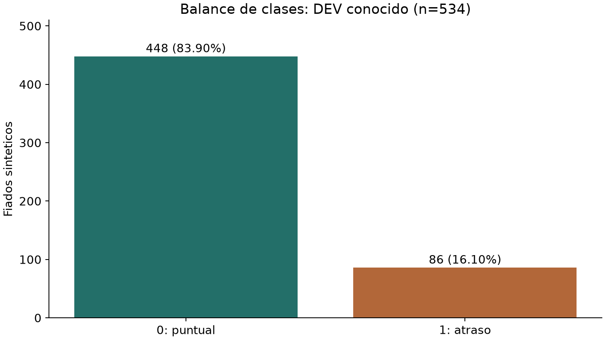
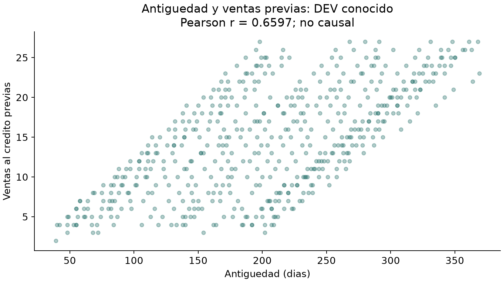
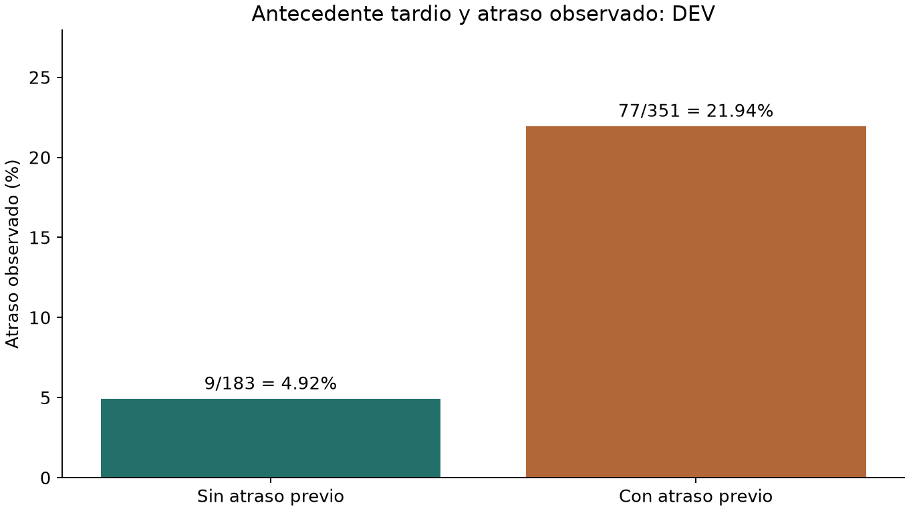

# Complemento generado para revision final

Documento independiente del informe (cuerpo de 15 paginas) y de la presentacion. No modifica su contenido ni afirma revision previa del grupo sobre este complemento. Analisis descriptivo post hoc de DEV, posterior al congelamiento del modelo: no selecciona variables, parametros, umbrales ni disena FINAL.

## 1. Poblacion y estadisticas

Fuente: development/development_known.csv, SHA-256 4099ddba545eea26681e133c84cbb705488cfe1922c7085ca4ac71ceefafc544. Son 534 fiados simulados elegibles con desenlace conocido; no son 534 clientes independientes. Los siete desenlaces desconocidos de DEV elegible no se imputan ni entran aqui. Las replicas son historias alternativas, no volumen real sumable.

estadisticas-dev.csv conserva las once variables y el objetivo binario, con n, faltantes, valores unicos, media, desviacion muestral (n-1), minimo, cuartiles interpolados linealmente (posicion (n-1)p), mediana y maximo. Para el objetivo, la media es la proporcion de clase 1, no una magnitud continua. balance-clases-dev.csv conserva los conteos y porcentajes exactos.

| Clase | n | % |
| --- | --- | --- |
| 0 | 448 | 83.895131 |
| 1 | 86 | 16.104869 |

Las cinco variables de deuda son constantes cero por elegibilidad: pending_overdue, pending_current, outstanding, utilization y overdue_rate. completed_sales coincide con paid_credits; representa ventas al credito ligadas al historial, no ventas al contado ni dos senales independientes. No se altera el contrato de once campos.

| Variable | Media | DE | Min | Mediana | Max |
| --- | --- | --- | --- | --- | --- |
| completed_sales | 14.477528 | 6.604795 | 2.000000 | 14.000000 | 27.000000 |
| paid_credits | 14.477528 | 6.604795 | 2.000000 | 14.000000 | 27.000000 |
| paid_late | 2.102996 | 2.555697 | 0.000000 | 1.000000 | 11.000000 |
| pending_overdue | 0.000000 | 0.000000 | 0.000000 | 0.000000 | 0.000000 |
| pending_current | 0.000000 | 0.000000 | 0.000000 | 0.000000 | 0.000000 |
| outstanding | 0.000000 | 0.000000 | 0.000000 | 0.000000 | 0.000000 |
| utilization | 0.000000 | 0.000000 | 0.000000 | 0.000000 | 0.000000 |
| requested_ratio | 0.271067 | 0.106372 | 0.084000 | 0.256250 | 0.618750 |
| tenure_days | 204.168539 | 77.351938 | 39.000000 | 204.500000 | 369.000000 |
| punctuality_rate | 0.843628 | 0.178342 | 0.000000 | 0.902381 | 1.000000 |
| overdue_rate | 0.000000 | 0.000000 | 0.000000 | 0.000000 | 0.000000 |
| late_payment | 0.161049 | 0.367921 | 0.000000 | 0.000000 | 1.000000 |

## 2. Relaciones descriptivas DEV

Relacion 1: antiguedad frente a ventas al credito previas. Pearson r = 0.659683550279, calculado con statistics de la biblioteca estandar sobre las 534 filas. La asociacion no demuestra que la antiguedad cause ventas: ambas evolucionan con el historial simulado y hay observaciones repetidas por cliente. No se calculan p-valores ni intervalos que supongan independencia.

Relacion 2: paid_late > 0 frente al desenlace late_payment observado del nuevo fiado.

| Antecedente tardio | n | Puntuales | Atrasos | Tasa % |
| --- | --- | --- | --- | --- |
| No | 183 | 174 | 9 | 4.918033 |
| Si | 351 | 274 | 77 | 21.937322 |

Diferencia (con antecedente menos sin antecedente): 17.019289 puntos porcentuales. En estos datos la tasa es mayor con antecedente. No es una regla determinista, efecto causal, validacion real ni evidencia independiente por transaccion. No cambia el modelo congelado.

## 3. Criterio tecnico predeclarado

Fuente original: experiment/APF3_PENDING_V6_MODEL_PROTOCOL.json, success_proposal. Su texto tecnico literal es: Selected ML final policy F2 strictly exceeds both frozen Dummy policy F2 values, with capacity respected. La revision experiment/revision_protocol.json hereda el protocolo y conserva seleccion F2 OOF, baselines y cola. No se confunden las antiguas cifras DEV del protocolo historico con las 534 filas de esta revision V6 Final.

La seleccion fue por F2 de acciones OOF con capacidad de cinco alertas por replica y dia; el exito tecnico predeclarado se evalua en FINAL, superando estrictamente ambos Dummy con capacidad respetada. Los resultados siguientes se COPIAN de caches y reportes guardados, sin predicciones nuevas.

| Politica | F2 OOF | F2 FINAL | Max/dia OOF | Max/dia FINAL | Capacidad respetada |
| --- | --- | --- | --- | --- | --- |
| svm | 0.552367288379 | 0.606060606061 | 4 | 3 | True |
| most_frequent | 0.000000000000 | 0.000000000000 | 0 | 0 | True |
| constant_1 | 0.489749430524 | 0.470183486239 | 4 | 5 | True |

Se satisface la propuesta tecnica sintetica, no una meta comercial. SVM fue seleccionado en DEV con umbral 0.1; aunque otro modelo tenga mejor FINAL, no se cambia el ganador. OOF se reutilizo para seleccion y es optimista; las colas OOF son por fold, no una cola desplegable de toda la cohorte. Dos minutos por alerta y capacidad cinco son supuestos no cronometrados. F2 pondera recall por decision del equipo, no por costos reales medidos.

## 4. Nueva propuesta de meta de negocio

La referencia declarada por el propietario es aproximadamente 14 solicitudes, 12 creditos y nueve clientes por semana y 25-35 minutos semanales de revision. Es autorreporte aproximado, no cronometraje ni prueba de ahorro. Las referencias de volumen y tiempo no son una linea base instrumental medida.

PROPUESTA NUEVA DEL EQUIPO para un futuro piloto autorizado: reducir al menos 10% la mediana de minutos semanales de revision normalizados por volumen de solicitudes frente a una linea base medida, sin aprobaciones automaticas. No era una meta inicial predeclarada; no esta aceptada por el propietario y NO se ha demostrado alcanzada con los datos existentes. No se utiliza para juzgar FINAL retrospectivamente.

Antes del piloto, acordar con el propietario duracion y periodos comparables, procedimiento de cronometraje, volumen de referencia Vref y tolerancias de errores y costos. Registrar por semana minutos reales T y solicitudes N; para N>0 usar Tnorm = T * Vref / N. Comparar medianas de Tnorm en linea base y piloto: reduccion = 1 - mediana(piloto) / mediana(base), exigiendo >=0.10. Definir antes como tratar semanas N=0, estacionalidad y cambios de carga. Medir tambien tiempos de revision obligatoria, correcciones y uso del sistema, no solo alertas ML.

Monitorear atrasos omitidos (FN), falsas alertas (FP), errores operativos y sus consecuencias con desenlaces maduros. El propietario debe acordar ANTES del piloto tolerancias y reglas de pausa; no se inventan costos ni umbrales de seguridad ya aceptados. La meta de tiempo no puede compensar incumplir esas tolerancias. Todas las decisiones de credito siguen siendo humanas; elegibilidad o score bajo nunca significan aprobacion automatica.

## 5. Tres errores ya citados en el PDF

Se verifico por extraccion de texto que el PDF existente ya cita L00051, L00054 y L00058. Se conservan sin modificar sus paginas. Fuente: experiment/final_cache_svm.json; tres primeros errores por ID. No se ejecuta el modelo ni se produce una nueva evaluacion FINAL.

### PND6F-R1-T-L00051 (FN)

Real=1; predicho=0; score=0.087818692982; umbral=0.1. Historial: 4 pagados, 0 tardios, puntualidad=1.000000, antiguedad=115 dias y solicitud/cupo=0.337500. Deuda previa cero. Cuatro creditos anteriores puntuales pueden aportar una senal insuficiente del proximo atraso. La representacion y aproximacion del modelo producen un score bajo el umbral; no se conoce la causa del atraso.

### PND6F-R1-T-L00054 (FP)

Real=0; predicho=1; score=0.226319083981; umbral=0.1. Historial: 3 pagados, 1 tardios, puntualidad=0.666667, antiguedad=39 dias y solicitud/cupo=0.262500. Deuda previa cero. Un atraso entre tres creditos anteriores puede inducir sobrealerta en esta representacion; el score supera el umbral aunque el desenlace es puntual.

### PND6F-R1-T-L00058 (FN)

Real=1; predicho=0; score=0.087985981309; umbral=0.1. Historial: 4 pagados, 0 tardios, puntualidad=1.000000, antiguedad=191 dias y solicitud/cupo=0.157875. Deuda previa cero. Cuatro creditos anteriores puntuales tampoco garantizan puntualidad posterior; historial escaso y aproximacion del modelo son hipotesis de senal insuficiente, no causas demostradas.

Las explicaciones son hipotesis sobre representacion, umbral y aproximacion del modelo; no causas estadisticamente confirmadas. No se atribuyen problemas de liquidez ni eventos financieros no observados.

## 6. Pruebas complementarias de reglas previas

pruebas-reglas-previas.json registra SIETE ejecuciones nuevas del helper puro revision/policy.py mediante importlib: deuda vigente, vencida, saldo parcial, deuda prioritaria aun sin historial, sin historial, saldo desconocido y elegible (None). Se comprueban ruta, razon no vacia, indicador de revision manual, contrato de once campos e inmutabilidad del diccionario de entrada. Se copia el SHA-256 de la fuente; no se modifica ni se carga joblib.

Cero llamadas ML corresponde EXCLUSIVAMENTE a estos siete checks: no es una auditoria de las llamadas del entrenamiento completo. El JSON es evidencia nueva con horas reales de esta ejecucion, no restauracion de un archivo historico faltante. Las pruebas son unitarias del enrutamiento, no certificacion del validador numerico ni de integracion completa. None significa elegible para evaluacion, no credito aprobado.

## 7. Prompts, IA y revision

prompts-complemento.md conserva literalmente la solicitud del usuario que autoriza completar lo faltante sin cambiar el contenido del informe ni de la presentacion. Las instrucciones operativas del complemento se documentan aparte como resumen, no como cita literal del usuario. No se reconstruyen supuestos prompts historicos ni se afirma que sean todos los usados en el proyecto. Se mantiene el contexto de declaracion de IA del proyecto existente.

Segun confirmacion del usuario, el Anexo C existente fue revisado por el mismo grupo. Esa confirmacion NO se extiende a este material nuevo: complemento generado para revision final, pendiente de lectura y aprobacion del grupo. No se atribuye validacion al propietario ni al docente.

## 8. Checklist de cobertura y pendientes

| Evidencia / accion | Estado y limite |
| --- | --- |
| Estadisticas de once features y clases DEV | Generadas en CSV; 534 conocidos; sin modificar fuentes |
| Dos relaciones y balance de clases | Tres PNG y calculos descriptivos reproducibles |
| Meta tecnica original y baselines | Recuperada del protocolo; resultados copiados de caches |
| Meta de negocio cuantitativa | Propuesta futura >=10%; no aceptada ni demostrada |
| Tres errores FINAL | Cache reutilizado; casos ya citados en PDF; hipotesis prudentes |
| Siete reglas previas | Nueva ejecucion unitaria; no evidencia historica restaurada |
| Prompts y declaracion IA | Solicitud actual literal y resumen operativo; no historia completa |
| Revision de este complemento por el grupo | Pendiente; no se afirma completada |
| Cuenta y ejecucion real en Colab | No verificadas en vivo; requiere comprobacion humana |
| Ensayo de sustentacion de 12 minutos | No verificado; requiere ensayo cronometrado |
| Aula y entrega academica | Estado desconocido; no se acceso a la cuenta |
| Piloto y aceptacion del propietario | Pendientes; no autorizacion de produccion |

Documentos de entrega: informe/APF3_TD_Grupo2_ML_Innovacion.pdf y sustentacion/APF3_TD_Grupo2_ML_Innovacion.pptx. Este generador no renombra ni edita ningun archivo de esas carpetas. Esta cobertura complementaria no certifica requisitos de la consigna no disponibles para cotejo ni acceso a cuentas, demo publica o GitHub.

## 9. Reproduccion y preservacion

Desde la raiz del proyecto, crear y activar un entorno aislado con Python 3.11 o superior. En macOS/Linux: python3 -m venv /tmp/apf3-anexos-venv y luego source /tmp/apf3-anexos-venv/bin/activate. En Windows puede usarse una ubicacion temporal equivalente y su script de activacion. Instalar las versiones fijadas con python -m pip install -r tools/requirements-anexos.txt; ejecutar python -B tools/completar_anexos.py. No es necesario instalar las dependencias ML del proyecto para este complemento.

El directorio de trabajo temporal se obtiene mediante tempfile.TemporaryDirectory(), respetando la configuracion temporal del sistema (por ejemplo TMPDIR), sin rutas locales fijas. Matplotlib usa Agg y configuracion temporal; PDF independiente mediante ReportLab. No hay entrenamiento, tuning, nuevas inferencias, diseno FINAL, acceso publico ni cambios en archivos originales.

manifiesto-complemento.json conserva SHA-256 de salidas, generador, dependencias y fuentes protegidas antes/despues; verificacion-complemento.json registra comprobaciones de esta ejecucion. Una segunda ejecucion con fuentes y salidas intactas verifica los hashes y no sobrescribe nada. Al actualizar el generador solo se regeneran salidas propias cuyo hash anterior siga intacto. Se admiten exclusivamente los dos renombres documentales conocidos con contenido identico; cualquier otro cambio de fuentes o salida ajena/modificada detiene la generacion.
